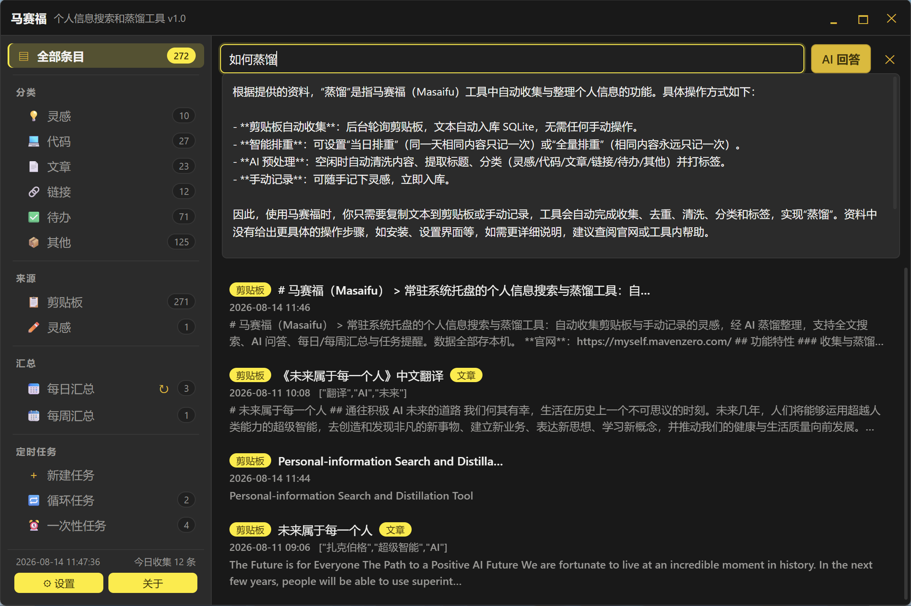
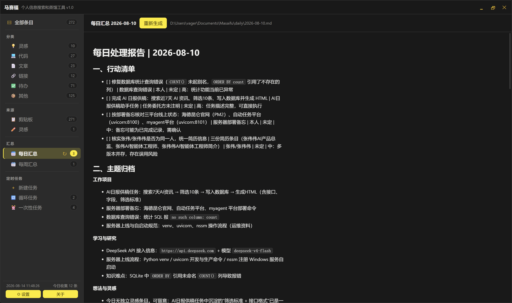
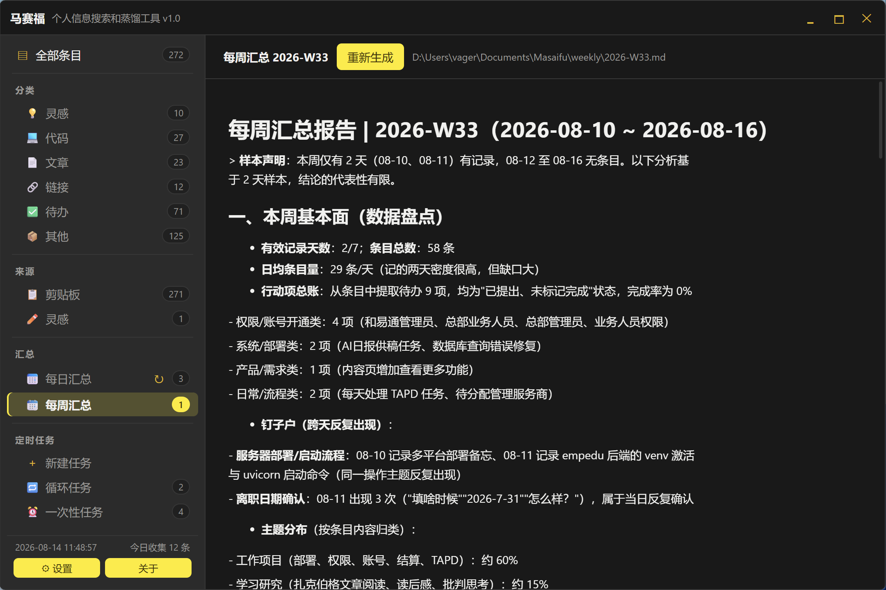
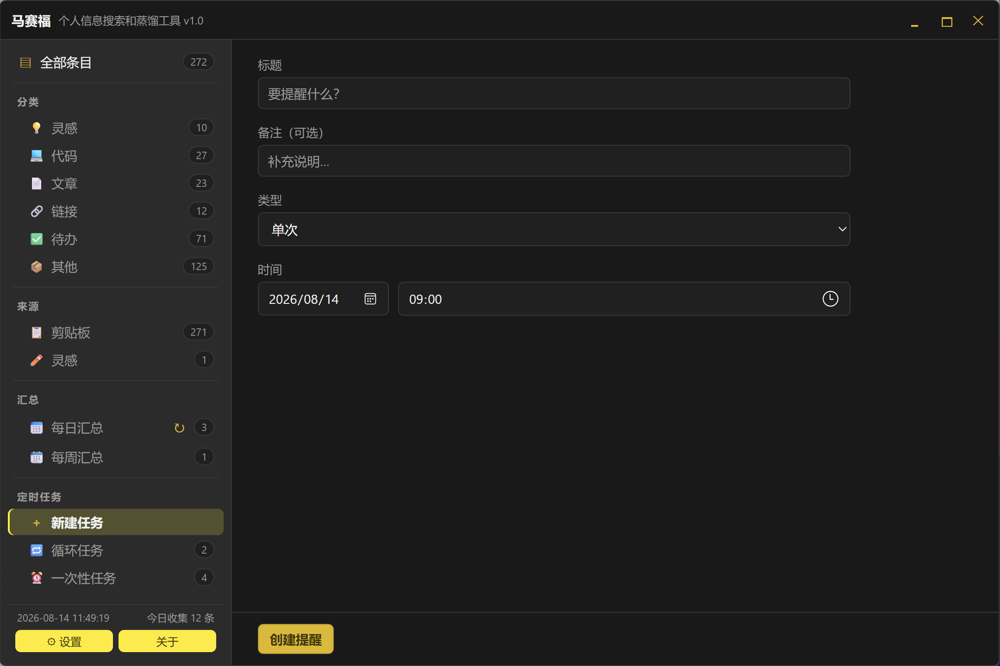

# 马赛福（Masaifu）

> 常驻系统托盘的个人数字分身：自动收集剪贴板与手动记录的灵感，导入会议录音自动转写并生成纪要，BLE 录音卡自动同步转写，AI 洞察提炼「要做的 / 未闭环」事项，支持全文搜索、AI 问答、每日/每周汇总与任务提醒。数据全部存本机。

**官网**：https://myself.mavenzero.com/

## 截图

| AI 搜索与问答 | 每日汇总 |
| --- | --- |
|  |  |

| 每周汇总 | 任务提醒 |
| --- | --- |
|  |  |

## 功能特性

### 收集与蒸馏

- **剪贴板自动收集**：后台轮询剪贴板，文本自动入库 SQLite，无需任何操作；设置页可随时关闭监控
- **智能排重**：支持「当日排重」（同一天相同内容只记一次）或「全量排重」（相同内容永远只记一次），设置页可切换
- **AI 预处理**：空闲时自动清洗内容、提取标题、分类（灵感/代码/文章/链接/待办/其他）并打标签
- **手动记录**：随手记下灵感，立即入库

### 会议录音

- **音频导入转写**：浏览页导入常见音频格式（mp3/m4a/wav 等），本地解码后经 SenseVoice 模型离线转写，全程不联网
- **发言人分离 + 时间戳**：CAM++ 声纹模型自动区分说话人，转写文本带 `[说话人N mm:ss]` 前缀
- **AI 会议纪要**：转写全文自动送入 AI 生成结构化纪要，提示词模板可自定义；详情页「会议纪要 / 原始内容」页签随时对照
- **朗读纪要 / 原文**：本地 Kokoro 中文语音合成（纯离线），边合成边播、8 个音色可选、支持暂停与倍速；合成结果按文本缓存，重播秒开
- **进度可视**：解码、说话人分析、逐块转写、纪要生成各阶段均有进度条
- **模型按需下载**：首次使用从 ModelScope 一键下载语音识别 / 端点检测 / 声纹三个模型（约 260MB），朗读功能另需语音合成模型（约 130MB），设置页查看状态

### 录音卡

- **BLE 自动同步**：App 常驻连接录音卡，按同步窗口（默认今日 + 昨日，天数可调）自动下载新录音，全程不联网
- **下载即转写**：同步完成的录音自动走转写流水线入库，并静默生成 AI 纪要 + 深度解析，浏览页「录音卡」来源集中查看
- **设备面板**：实时连接状态、手动连接 / 断开、按 MAC 绑定设备（同名设备再多也只连绑定的那张）
- **归档与清理**：录音本地归档保留（默认 30 天，可配），同步后自动清理设备空间

### 录音洞察

- **自动分析**：按可配置间隔自动分析录音深度解析，产出四类发现——「我要做的 ⭐」「别人答应的」「灵感」「未闭环 ⭐」，汇总区「录音洞察」页签查看
- **项目脉络**：跨天追踪同一项目的来龙去脉，不再散落各处
- **发现即行动**：任意发现可一键转为提醒或条目，也可忽略；⭐ 标记的未闭环事项不再遗漏

### 搜索与问答

- **全文搜索**：SQLite FTS5（trigram）全文检索，输入即出结果，条目与汇总混合命中，关键词高亮
- **AI 兜底搜索**：直接搜索无结果时，AI 自动从输入中提取多个搜索词分别重搜，各取前 5 条排重后呈现
- **AI 回答**：基于命中的资料生成回答，末尾附引用来源；搜索结果页内一键触发

### 汇总与提醒

- **每日汇总**：定时生成当日 Markdown 汇总（本地文件 + 库内记录 + 托盘提醒），提示词模板可自定义；每日汇总页可点「立即汇总」手动生成当天汇总
- **每周汇总**：按配置的星期与时间自动生成上周（周一至周日）AI 周报，独立提示词模板；每周汇总页可手动选择汇总上周或本周
- **任务提醒**：单次 / 每天 / 每周提醒，到点弹出系统通知；错过的提醒不补发，循环提醒自动推进

### 窗口与体验

- **单一全量窗口**：左侧分类树浏览 + 右侧条目管理，点托盘图标或全局快捷键直接唤起
- **窗口状态记忆**：记住窗口大小与位置，下次启动自动恢复
- **主题**：亮色 / 暗色 / 跟随系统，Notion 风格界面
- **状态栏**：侧栏底部实时显示当前日期时间与今日收集条数

## 安装

从 [Releases](https://github.com/vagerent/myself/releases) 下载 Windows 安装包（NSIS），或自行构建：

```bash
npm install
npm run tauri build
```

安装包输出在 `src-tauri/target/release/bundle/`。如需会议录音功能，打包前先按 `tools/build_sidecar.md` 构建 sidecar（产物会一并打进安装包）。

## 开发

前置要求：Node.js 18+、Rust 工具链（Tauri 2 依赖，Windows 需 MSVC Build Tools）。会议录音功能还需要先按 `tools/build_sidecar.md` 构建语音转写 sidecar（缺省时其余功能不受影响）。

```bash
npm install
npm run tauri dev
```

## 使用

- **唤起窗口**：全局快捷键（默认 `Ctrl+Alt+Space`）或左键点击托盘图标；`Esc` 隐藏窗口
- **托盘菜单**（右键）：打开搜索、今日汇总、任务提醒、设置、退出
- **主窗口**：左侧分类树（全部 / 分类 / 来源 / 每日汇总 / 每周汇总 / 录音洞察 / 定时任务），右侧条目列表与详情；搜索在当前选中节点内过滤，无结果时自动进入 AI 兜底搜索；列表超过 20 条自动分页；支持手动记录灵感
- **设置页**：左侧分类导航（AI 服务 / 汇总 / 会议录音 / 通用），含 API Key、模型、base_url、汇总时间、每周汇总（星期几 + 时间）、空闲阈值、快捷键、Markdown 输出目录、各类提示词模板、录音卡（启用 / 同步窗口 / 绑定设备 / 归档天数）、语音模型下载、排重方式、主题、开机自启、剪贴板监控开关

> AI 功能（预处理、汇总、问答、兜底搜索、会议纪要、录音洞察）依赖 OpenAI 兼容的 Chat Completions API，未配置 API Key 时自动跳过，不影响收集与搜索。语音转写与朗读均为纯本地离线推理，不需要 API Key。

## 技术栈

- **后端**：Tauri 2（Rust）、rusqlite（SQLite + FTS5 trigram）、reqwest（OpenAI 兼容 API）、symphonia + rubato（音频解码与重采样）
- **语音转写**：PyInstaller 冻结的 funasr-onnx sidecar（SenseVoiceSmall 识别 + FSMN-VAD 端点检测 + CAM++ 说话人分离），构建方法见 `tools/build_sidecar.md`
- **语音合成**：PyInstaller 冻结的 Kokoro sidecar（Kokoro-82M v1.1-zh ONNX fp16 + misaki[zh] G2P），构建方法同见 `tools/build_sidecar.md`
- **前端**：Svelte 4 + TypeScript + Vite

## 数据位置

| 数据 | 位置 |
| --- | --- |
| SQLite 数据库 / 设置 / 窗口状态 | `%APPDATA%\com.masaifu.desktop\` |
| 语音模型（识别 / VAD / 声纹 / 合成） | `%APPDATA%\com.masaifu.desktop\models\` |
| 朗读音频缓存 | `%APPDATA%\com.masaifu.desktop\tts-cache\` |
| 每日汇总 Markdown | `文档\Masaifu\daily\YYYY-MM-DD.md`（可修改） |
| 每周汇总 Markdown | `文档\Masaifu\weekly\YYYY-Www.md` |

## 隐私说明

- 所有数据（剪贴板记录、灵感、录音与转写、汇总）仅保存在本机，不上传任何服务器
- 仅在你配置 API Key 后，条目内容会发送到你自配置的 AI 接口用于预处理/汇总/问答
- 剪贴板默认全量收集（可在设置中关闭监控），不做敏感内容过滤，请自行评估使用场景

## Roadmap

- 语义搜索（向量检索）
- 图片 / 文件捕获
